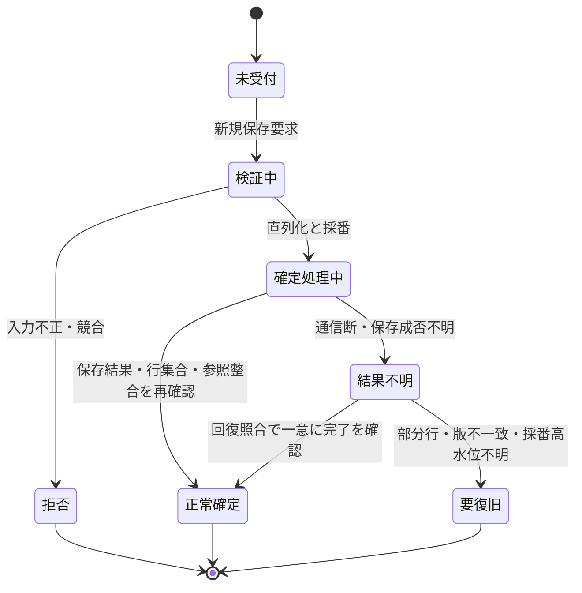

# OPN-DD-14 — ID採番・正常確定順・競合制御 詳細設計レビュー

> 文書状態：**Decision Record v0.2／DD14-01 Option A Approved（2026-11-16）／OPN-DD-14論理制御方式Closed**  
> 作成日：2026-11-16（JST）  
> プロジェクト内保存先：`docs/design/OPN-DD-14_ID_Sequencing_Concurrency_Review.md`  
> レビュー時点の参照資料（決裁後は順にDraft v0.7、Test Design Draft v0.3、Decision Draft v0.7、Change Draft v0.8へ更新）：`docs/design/MVP_Design.md` Draft v0.6、`docs/test/Test_and_Validation.md` Test Design Draft v0.2、`docs/decisions/Decision_Log.md` Draft v0.6、`docs/changes/Change_Log.md` Draft v0.7、`docs/design/OPN-DD-10_Data_Model_Review.md` Decision Record v0.2、`reference/AI協働開発_基本運用プロセス.md`。  
> 承認履歴の取扱い：**詳細設計Q01〜Q24、CONS-DD-01 A、DD10-01 A、DD11-01 B、DD12-01 A、DD13-01 Aは不変更**。本レビューはDD14-01 Aとして採用した論理制御契約の履歴を保持する。物理制御・実機保証は未検証であり、後工程で確定する。

## 0. 目的・スコープ

**目的**：複数行を伴うExcel単一原本の書込みに対し、(1) テーブル別連番の一意性・不変性・非再利用、(2) `HistoryID`／`ReviewID`の最大正常確定IDが最新の確定操作に一致すること、(3) 同時操作での競合・上書きを抑止すること、(4) 部分保存／通信断／再試行時に不完全データを正常確定と誤認しないこと、の**レビュー可能な方式を提案**する。

- **DD14-01 A承認済（2026-11-16）**：書込主体の直列化方式、発番・確定順の論理契約、正常確定／曖昧な保存結果の扱い、OPN-DD-15へ引き継ぐ失敗境界。
- **Later／実装と並行して検証**：Excel Windows／Webおよび選定保存先（Box第一候補／SharePoint Online代替）での排他・自動保存・同時操作・保存結果検出・復元可能性。設計承認は機能保証ではない。
- **Not Now**：新規承認ワークフロー、複数書込者による同時更新の積極対応、外部DBへの正本移行、別系統の定期バックアップ追加、先行独立PoC、VBA／Office Scripts必須化。

## 1. 根拠と既決事項：変更しない

| 論点 | 確定仕様・根拠 | 今回残る実装問題 |
|---|---|---|
| Q06=B／Q02=A | `ProjectID`等は**テーブル別連番・単独不変PK**、再利用・重複を禁止 | 連番カウンタの更新と複数行保存、復元後の非再利用 |
| Q07=A | 保存時＋全体整合性チェック。参照不正や重複を正常保存しない | 部分保存の検出・書込停止・復旧の境界 |
| Q11=A／Q09〜Q14 | `tblDateHistory`の対象別**正常確定・最大`HistoryID`**が代表日付の正本。変更・取消・訂正は追記 | 発番順と**実際の確定順**が逆転しないこと |
| DD10-01=A | `tblReconciliationReview`は追記専用。`CommitStatus=正常確定`の最大`ReviewID`で現在の照合状態を導出 | 初回差異登録＋初回レビューの整合確定、レビューの確定順 |
| Q18=A／DD11-01=B | `OccurrenceNo`は`ProjectEventID`内の別回次。`OccurrenceStatus`が正本、状態監査表は置かない | 新規回次と初回日付履歴の整合保存、状態と日付の整合確定 |
| CONS-DD-01=A／Q08=A | 案件登録時に全ステージ・全イベント適用行を生成。マスタ差分同期は管理者が明示実行 | 一括登録の部分成功を正常とみなさない。同期再実行はOPN-DD-15 |
| Q19〜Q22 | 原本編集は管理担当者に集約、閲覧専用表示。正本保存後に表示再生成 | 誰が書込権限を保持し、確定と表示更新の境界を区切るか |
| DD13-01=A | 14親＋16詳細＋T13-01、計31管理ID。**全件 Not Tested** | 既存TEST-DD-001/003/004/007/013/014に採番・競合の試験観点を補う |

**重要な区別**：`RecordedAt`／`ComparedAt`は記録日時であり、確定順の代用にはしない。`MAX(HistoryID)`と`MAX(ReviewID)`を保持する既決仕様を、日時順や別の代表日付正本へ変更しない。

## 2. 優先リスクと不変条件

| ID | リスク／失敗シナリオ | 守るべき不変条件 | 失敗時の処置案 |
|---|---|---|---|
| INV-14-01 | 2セッションが同時に`MAX(ID)+1` | 同一テーブルの確定PKに重複なし | 重複候補を確定拒否、書込を停止 |
| INV-14-02 | 先に採番した履歴が後から確定 | 同じ対象の**正常確定**履歴では、後に確定した行のIDが大きい | 1操作ずつ直列化し、先行操作が完了/破棄されるまで次を公開しない |
| INV-14-03 | レビュー再照合の確定順逆転 | `ReviewID`最大の正常確定行が当該差異の最新確認 | `HistoryID`と同じ発番・順序規則を適用 |
| INV-14-04 | 案件のみ保存され子適用行が不足 | 案件＋全初期Stage/Event行を**ひとまとまりとして検査** | 一式未成立なら正常確定・日程表示に供給しない |
| INV-14-05 | 開催回だけ確定し初回履歴が未保存 | 回次UQ・開催回と必須初回日付の整合 | 孤立・未確定行を拒否。OPN-DD-15で復元・再試行 |
| INV-14-06 | 差異案件だけ作られ初回レビューなし | 差異案件＋初回`要確認`レビューを整合確定 | 片側だけのデータを要確認の正本にしない |
| INV-14-07 | 保存エラー後の自動再試行が二重追加 | 同一要求の再送は**同じ確定結果に収束**するか停止 | 操作識別子で照合、結果不明の自動再実行禁止 |
| INV-14-08 | 古いファイル版へ復元後、IDを再利用 | 過去に使用したPKの再利用禁止、復元で歴史が消えたことを検知 | 高水位の確認まで更新停止。履歴・外部記録との照合が不能なら復旧未完了 |
| INV-14-09 | 読取中に未完成行や表示キャッシュが混入 | 正本・表示は**整合検証済みの確定版**に限る | 保留・古さ警告・更新停止、未完成データを公開しない |

**設計上の厳格な限界**：Excelファイルの複数行書込み、自動保存、版履歴復元がDBトランザクションや厳密な排他に相当するとは**確認されていない**。専用のコミット台帳や状態列だけでも物理原子性は成立しない。実装で「上記不変条件を保証できない」場合は**運用不可／Fail-closed**とし、技術方式または運用前提の変更を別途判断する。

## 3. DD14-01の選択肢（2026-11-16決裁：A採用、B/C不採用）

| 方式 | 提案仕様 | 長所 | トレードオフ／評価 |
|---|---|---|---|
| **A（AI推奨）単一書込者・直列コミット管理** | 書込担当者を1名・書込セッションを1本に制限。保存前全件検証、テーブル別発番高水位と要求識別による再送照合、操作単位の確定記録。曖昧な保存後は停止・整合照合。 | MVPの1名管理原則と整合、ID・履歴順の保証を論理的に単純化。多重同時編集を必要としない | 物理的に「1セッション」を守れる権限/運用・保存結果確認は未検証。技術補助管理領域が必要になる可能性 |
| **B 複数書込者・排他／版番号条件付き更新** | 各保存で原本版の比較、ロックまたはCAS相当の確定・再試行制御を行う。競合時は再入力/再評価 | 将来複数担当者への拡張余地 | Excel+保存先に必要な**原子的な条件付き更新機能があるか未確認**。複雑化・スコープ増を招く。MVP非推奨 |
| **C 単一書込者・簡易運用ロック** | 表示上の「編集中」宣言＋連番管理。操作台帳/再送識別は設けず、失敗時に目視復旧 | 実装が最も軽い | 保存結果不明時の二重登録・ID再利用・確定順を機械的に追跡しにくく、Q06/Q11/DD10条件への保証が弱い。非推奨 |

**推奨理由の区分**：A案を薦める理由はAIによる論理整合性・リスク評価である。**ユーザー固有の選択理由は提示されていない**。2026-11-16のA案明示承認を正式記録し、AI評価と混同しない。

## 4. A案の詳細デザイン（DD14-01 A承認済み／物理方式は未確定）

### 4.1 書込権限・更新セッション

1. **論理的に単一書込者**：管理担当者1名に原本の更新権限を限定し、同一人のWindowsとWebからの重複した編集セッション、同期待ちのローカルコピー、他アカウントとの共同編集も**原本更新として並列実行しない**。
2. 書込開始時に**原本版・確定済み操作の最新記録・未解決操作の有無**を確認する。競合または版不明なら新規書込不可。
3. 編集禁止をExcelのシート保護や「編集中」の表示のみで実現したものとみなさない。**保存先のアクセス権・開き方・共同編集設定を含め、Windows/Webとも実効的な書込制御が成立することを検証**する。
4. 保存先（Box／SharePoint Online）とExcelクライアントの組み合わせは未選定。**書込排他が立証できなければA案であっても運用開始不可**。VBA/Office Scriptsの採用は必須としない。

### 4.2 技術補助管理（論理要素はA案採用／物理方式未承認・追加業務正本ではない）

| 技術管理要素（仮） | 最小項目／用途 | 境界 |
|---|---|---|
| `tblIdSequence`（既存Draftの仮案） | `EntityName` PK／`LastIssuedID`／`UpdatedAt`。主要テーブル単位で**発番済み高水位**を管理（欠番許容） | 専用の**技術管理テーブル案**。`MAX(保存済行ID)+1`のみへの依存は禁止。物理保証未検証 |
| `tblSaveOperation`（**DD14-01 Aで論理要素として採用**） | `OperationKey`（冪等な保存要求の識別子）、`OperationType`、`BaseRevision`、`AllocatedIds`、`ExpectedRowSet`、`SaveState`、`CommittedRevision`、`LastError`等 | 業務データの正本ではなく**正常確定・再送照合の技術管理領域候補**。物理テーブル名/列は採用後の実装補完で調整可 |
| レコード側の関連付け | 新規複数行を保存要求`OperationKey`へ紐づける仕組み、正常確定状態/確定版を識別する手段 | `tblDateHistory.CommitStatus`は現行Draft列、`tblReconciliationReview.CommitStatus`はDD10-01で必須。その他のレコードの物理列追加は**今回未確定** |

- `OperationKey`は**再送識別用トークン**であり、テーブル別連番PKの代替ではない。操作を再試行しても同じ保存要求として検索できる必要がある。
- 新テーブルを導入しても**別の業務承認WFや外部データ正本を新設しない**。技術管理データをどのExcel機能で保護するか、保存後にどう検証するかは未実装／未検証。
- `tblIdSequence`と`tblSaveOperation`の**同時更新まで原子的と仮定しない**。故障時は以後の採番を止め、整合が実証されるまで「正常確定」を公開しない。

### 4.3 発番・確定順の契約

1. 既存のテーブル別独立連番を維持し、新規行のPKは発番済み高水位を超えるIDを割り当てる。**欠番は許容**。`ProjectStageID`、`ProjectEventID`、`MilestoneID`、`EvidenceID`、`HistoryID`、`ReviewID`等も各テーブル別に管理する。
2. `OccurrenceNo`は**`ProjectEventID`内の連番**として別に管理し、同じイベント内の重複禁止・再開催時は新回次を維持する。`OccurrenceNo`を全体PKとみなさない。
3. `HistoryID`と`ReviewID`はそれぞれ**確定待ち操作の直列キューで発番し、先行操作が `確定` または `破棄（再使用不可）` となるまで後続を正常確定しない**。IDを先取りした未確定操作が後から確定し、より大きいIDの既確定操作を追い越すことを禁止する。
4. 後から入力した`RecordedAt`／`ComparedAt`は並べ替え条件に使用しない。対象別代表日付=正常確定・最大`HistoryID`、差異状態=正常確定・最大`ReviewID`の既決規則を維持する。
5. 未確定／失敗行は最新値の導出から除外。**確定済み履歴・レビューの変更／削除は禁止**。空欄取消は最新正常確定である限り代表日付をNullにする。
6. **復元による高水位の巻戻しは別問題**：保存先の版履歴から過去に発番された最大値を照合し、それを下回る番号を採用してはならない。復元後の照合に必要な情報が失われた場合は更新停止し、OPN-DD-15／OI-DD-02で復旧手順を決める。**すべての旧版・外部照合先が見つからない場合、非再利用の保証はできない**。

### 4.4 保存と状態遷移（論理プロトコル）

**`正常確定`の必要条件（全て）**：

- 書込要求が単一で競合なし／開始時の原本版と書込基点が一致。
- 必須行の**期待集合**が揃い、PK・FK・UQ・論理FK・日付／状態の業務制約を全体照合している。
- 対象操作に対応するID・`OccurrenceNo`・`CommitStatus`・保存要求が一貫し、`HistoryID`／`ReviewID`確定順が逆転していない。
- 保存先に反映された原本版と全行を**再読込・照合**し、操作が**一度だけ**存在すると確認できる。画面の「保存しました」表示や自動保存の点灯だけでは判定しない。

**論理処理手順（提案）**：

1. 管理者が操作要求を発行し、要求ごとに`OperationKey`を発行。`BaseRevision`の一致と未解決操作なしを検査。
2. 入力・参照・全件生成件数をメモリ上／安全な隔離領域で先に検証。発番高水位と新規行の候補を直列化中に割当。
3. 保存要求を**一操作単位**として適用。多行の途中状態は論理的に保留扱い。基盤が原子的な保存を保証しない場合、暫定行や未確定版を閲覧者に**正常確定と誤表示しない仕組みが必要**。
4. クラウド原本を再取得し、期待する全行集合・採番・参照・確定状態・操作識別子・原本版を照合。**すべて一致**した場合だけ正常確定として表示更新へ渡す。
5. 照合が失敗、競合、通信断で結果不明なら**以後の保存と表示確定を停止**。同じ`OperationKey`で保存済みかを調査し、無条件に再発番・再送しない。
6. 表示再生成が失敗しても**正本の正常確定を巻き戻さず**、古さ警告と管理者再更新（Q20〜Q22／OPN-DD-15）へ進む。

**注意**：手順3〜4の成立には、物理的な未確定行隔離と確定版の公開タイミングの実装が必要。Excelの共同編集・自動保存は**この条件を自動的には満たさない**。隔離・再読込・版照合ができない場合は方式Aの条件未達として扱い、実装時に仕様変更を起票する。

### 4.5 失敗境界とOPN-DD-15への引継ぎ

| 状況 | DD14の論理的処置 | OPN-DD-15で定義・検証すること |
|---|---|---|
| 入力不正・業務UQ重複・参照不正 | 発番前に拒否／正本不変更 | UIエラー文言、該当行・項目と是正操作 |
| 保存前の競合・別セッションを検知 | 競合として停止、再読込→再入力／再検証 | 競合時の画面・セッション終了と再開手順 |
| 書込中に切断／自動保存で部分同期 | 結果不明、二重送信せず更新停止 | 実際の残存行・版を調べ、部分行を復旧・無効化する手順 |
| 片側のみ残存（Projectと適用行、Reconciliationと初回Review） | 期待行集合未成立なら正常確定にしない | 隔離・除去・復元／整合再検証、破壊的な直接編集の禁止 |
| 直列キューに未完了IDがある | 次の正常確定をブロックし高水位を維持 | 中断操作の確定／破棄を再開前に判定する手順 |
| 履歴版復元でカウンタ・操作記録が巻戻り | 非再利用の証明が得られるまで更新停止 | 高水位調査、復元後の整合性と版履歴保持・権限確認（OI-DD-02） |
| 正本確定後に表示データ更新が失敗 | 正本保持・古さ警告 | 表示リビジョン復旧・再生成、再実行による重複発生の防止 |

### 4.6 インフラ・セキュリティ上の成立条件

- 保存先選定前の設計上の前提は「**原本は1ファイル、管理担当者が原則1名のみ更新、他ユーザーは閲覧**」。1人であっても複数端末／Webセッションからの並行更新を許さない。
- **[外部参考情報／仕様保証ではない]** Microsoftの共同編集ガイダンスでは複数ユーザーが同じブックを編集し、保存内容が競合し得ることが説明されている。BoxもOfficeデスクトップ／Webの共同編集と自動保存をサポートするが、これを連番発番の排他・DB型トランザクション保証とは解釈しない。詳細は§7を参照。
- 完了判定を後付けのログセル更新だけに依存しない。**クラウド原本を再取得して、同じ版の期待行集合を検証すること**が不可欠。同期やキャッシュの影響があるならその検知法は実機検証事項。
- 保存先の版履歴保持、復旧権限、破損時の復旧後整合確認は**OI-DD-02／基本設計EXIT-06 Not Met**のまま。RISK-DD-04は**Not Tested**。

## 5. 受入観点（12件は引き続き候補・既存31テストを改変しない）

次はレビュー用**候補テスト観点**であり、DD13-01承認済みのテストIDを追加・変更する決裁ではない。**DD14-01 A承認は方式の採否であり、C14-01〜12の正式採用ではない**。`Test_and_Validation.md` Draft v0.3 §5.3で候補12件の**正式採用状態＝候補・未承認**／**実施状態＝Not Tested**を分離して管理する。正式管理件数は**31件すべてNot Tested**のまま。

| 候補ID | 既存関連親 | 条件・操作 | 合格期待値案 | 実施結果 |
|---|---|---|---|---|
| C14-01 | TEST-DD-001/013 | 並行セッションで同じ採番を要求 | 原本に同一PKを二重確定しない。競合時は一方拒否／停止 | Not Tested（候補） |
| C14-02 | TEST-DD-004/013 | 同じ対象に2履歴を競合登録 | 正常確定の時系列と最大HistoryIDが一致。低ID後確定なし | Not Tested（候補） |
| C14-03 | TEST-DD-007/013 | 同じ差異に2Reviewを競合登録 | 正常確定順とReviewID大小が一致 | Not Tested（候補） |
| C14-04 | TEST-DD-003/013 | 同じProjectEventに再開催を2回要求 | OccurrenceIDとOccurrenceNoが各一意、別開催回は別ID | Not Tested（候補） |
| C14-05 | TEST-DD-001 | 案件登録の途中で通信切断 | 親＋全Stage/Event行が揃わなければ正常確定扱いにしない | Not Tested（候補） |
| C14-06 | TEST-DD-007 | 差異登録と初回レビューの片側だけ保存 | 現在の照合状態に不完全案件を反映しない | Not Tested（候補） |
| C14-07 | TEST-DD-003/004 | 開催回初回日付だけ保存失敗 | 開催予定回を正常な日付設定済みとして扱わない | Not Tested（候補） |
| C14-08 | TEST-DD-013 | 保存結果不明の同一要求を再送 | 二重登録・再発番を避け、曖昧なら停止する | Not Tested（候補） |
| C14-09 | TEST-DD-013/014 | 復元で発番高水位が巻戻り | 高水位再照合を行うまで書込再開しない | Not Tested（候補） |
| C14-10 | TEST-DD-008/014 | 正本確定後、表示更新のみ失敗 | 正本とIDは維持。古さ警告・再生成で二重追加なし | Not Tested（候補） |
| C14-11 | TEST-DD-013/014 | Windows/Webと保存先で排他・セッション重複を試す | 排他が証明できなければA案の成立をNot Met／Blocked扱い | Not Tested（候補） |
| C14-12 | TEST-DD-013 | 取消行の確定後に先行設定行が遅れて確定 | 先行行の後確定を禁止し、代表日付は取消後Null | Not Tested（候補） |

## 6. 承認結果・Exit／変更管理

| 項目 | 状態と処置 |
|---|---|
| DD14-01 | **2026-11-16／ユーザーがOption Aを明示承認**。論理制御契約のみ採用。B/C不採用。実機保証とは別 |
| OPN-DD-14 | **Closed（論理制御方式のみ）**。排他・原子的保存が成立するかは実機で条件付き検証、未成立なら再Open／変更管理 |
| Decision Log／Change Log／MVP_Design | **更新済**。`DD14-01 A` と `CHG-DD-14-01` を追記。既存Q01〜Q24／CONS-DD-01／DD10〜13の判断履歴は保持 |
| Test_and_Validation | **Draft v0.3に候補／採否／実施の管理欄を追加**。正式31管理IDはNot Tested、C14-01〜12は正式未採用かつNot Tested。ケース正式採用は別判断 |
| OPN-DD-15 | **Open**。部分失敗・再試行・版履歴復元・表示再生成の詳細な復旧手順と技術試験を担当 |
| OPS-DD11-01 | **Open**。開催済／中止の誤登録訂正は運用開始前に手順承認が必要。DD11-01 B（状態監査表なし）を変更しない |
| CFG-DD-10-01 | **Open**。マスタコードの実値・許容範囲は未確定 |
| 基本設計EXIT-06／Freeze | **Not Met／未実施**。性能・保存先・復元検証を省略しない |
| 詳細設計EXIT-DD-01〜10／Gate | **Not Evaluated／未判定**。DD14-01承認だけでMetにしない |
| Excel実装・全テスト | **Not Started／31管理ID Not Tested**。物理排他・保存の原子性・リトライ保証は未検証 |

**採用案が成立しない場合の扱い**：合理的に設計した論理規則でも、Excel Windows/Webの実環境において排他・更新確定・復元後のID非再利用が証明できない場合、当該機能を合格とせず、**OPN-DD-14再Openまたは仕様変更要求の正式起票**とする。原判断Q06/Q11/DD10-01を黙って緩和しない。

## 7. 外部参考情報（2026-11-16時点の公開仕様・未実機検証）

- Microsoft Support：Excel共同編集の概要・競合する更新の一般的な挙動。https://support.microsoft.com/ja-jp/excel/get-started/collaborate-on-excel-workbooks-at-the-same-time-with-co-authoring
- Microsoft Learn：Excel共同編集下では、編集セッション間で変更が同期されるがアドイン等はキャッシュ不整合に注意を要する。https://learn.microsoft.com/en-us/office/dev/add-ins/excel/co-authoring-in-excel-add-ins
- Box Support：Box for Microsoft Officeの共同編集と対応条件。https://support.box.com/hc/en-us/articles/5954058378899-Technical-Requirements-to-Enable-Co-Authoring-in-Box-for-Microsoft-Office

これらは共同編集／自動保存の機能説明であり、**本案件の管理ブックにトランザクション保証・単一書込ロック・連番の厳密単調性が備わることの証拠ではない**。

---

## まとめ / Summary

**日本語：** DD14-01 Aを正式採用し、単一書込者・直列コミット論理方式を確定した。既存31管理IDはすべてNot Tested。C14候補12件は正式未採用で実施も未了。物理保証・部分失敗の復旧はOPN-DD-15へ引き継ぐ。

**English:** DD14-01 Option A is approved for logical design. It uses one writer and serial commits. All 31 official tests are not tested. The 12 new test ideas are not approved yet. Recovery work remains in OPN-DD-15.
