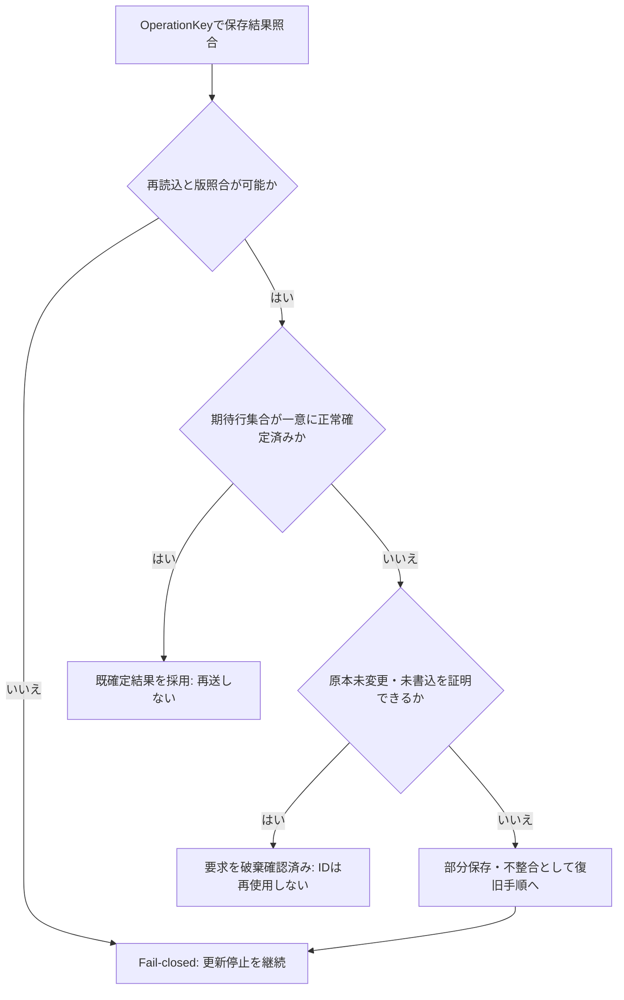

# OPN-DD-15 — 保存失敗・表示更新失敗・再試行・復旧 詳細設計レビュー

> **文書状態**：Review Draft v0.1／**DD15-01 未承認**（2026-11-17）  
> **フェーズ**：MVP詳細設計 In Progress／OPN-DD-15 Open  
> **プロジェクト内保存先**：`docs/design/OPN-DD-15_Recovery_Review.md`  
> **根拠**：`docs/design/MVP_Design.md` Draft v0.7（特に§5.1、§5.3、§6、§8〜9、§11〜13）、`docs/design/OPN-DD-14_ID_Sequencing_Concurrency_Review.md` Decision Record v0.2、`docs/test/Test_and_Validation.md` Test Design Draft v0.3、`docs/decisions/Decision_Log.md` Draft v0.7、`docs/changes/Change_Log.md` Draft v0.8、`reference/AI協働開発_基本運用プロセス.md`。  
> **判断境界**：詳細設計GrillMe Q01〜Q24、CONS-DD-01=A、DD10-01=A、DD11-01=B、DD12-01=A、DD13-01=A、DD14-01=Aを再審議しない。本書で提案するのは未確定の障害別復旧手順・表示鮮度の**論理仕様**。Excelの物理保証／版履歴保持・復元は未検証。

## 0. 目的・対象・非対象

**目的**：DD14-01 Aで採用した単一書込者・直列コミット／Fail-closedの契約を前提に、失敗検知から隔離・照合・復旧・再開までを一貫した論理手順として定義する。利用者に不確実な正本や未完成の表示を正常版と誤認させない。

**対象（Now）**：案件の一括登録、明示マスタ差分同期、開催回＋日付履歴、日付履歴追記、差異案件＋初回Review、再照合、表示データ再生成、保存要求の再送、版履歴からの復元。  
**依存（Later／実機）**：Excel Windows/Web、Box第一候補／SharePoint Online代替での確実な排他、保存完了通知、再読込の同一版性、版履歴の保持・復元、高水位の追跡、表示の公開タイミング、実行性能。  
**対象外（Not Now）**：外部DB・新規承認WF・追加定期バックアップ・自動通知・専用PoC前倒し・VBA/Office Scriptsの必須化・終端状態の通常UI訂正機能。終端状態の誤登録訂正運用は別課題 **OPS-DD11-01** に残す。

## 1. 既決事項との対応（変更不可）

| 根拠 | 維持する契約 | DD15で補完する点 |
|---|---|---|
| Q06=B／Q11=A／DD10-01=A | テーブル別連番を再使用しない。最新代表日付＝正常確定最大HistoryID、照合状態＝正常確定最大ReviewID | 失敗後・復元後の高水位確認と確定順の再開可否 |
| Q07=A／DD14-01=A | 保存時＋全体検証。単一書込者・直列コミット、`OperationKey`による再送照合、保存後原本再読込 | 部分保存と結果不明の識別・保留・復旧 |
| CONS-DD-01=A／Q08=A | 案件登録時全Stage/Event行を生成。マスタ同期は明示操作・既存行保持 | 一括処理の期待行集合、同期途中停止、差分再実行の安全性 |
| Q09〜Q14／DD11-01=B | 日付履歴追記・取消はNull・再設定は新規追記。状態正本はOccurrence。状態監査専用表なし | 正本未確定の履歴／状態更新を公開しない。状態誤登録訂正はOPS-DD11-01 |
| DD10-01=A | 差異案件＋初回要確認Reviewを一組として確定。レビューは追記専用 | 初回片側失敗・再照合の隔離と解消復旧 |
| Q20〜Q22／DD12-01=A | 正本保存成功後に共通表示データを再生成。表示失敗でも正本を巻き戻さず古さ警告 | 鮮度判定、表示再生成の再試行、閲覧可否 |
| DD13-01=A | 31管理IDはテスト設計として確定、全件Not Tested | C14候補とC15候補は採否／実施を別管理し、勝手に正式IDへ追加しない |

## 2. 故障分類・検知条件・即時処置（A案候補）

| 障害ID | 典型事象／検知条件 | 原本の判定 | 管理者の即時処置 | 閲覧表示 |
|---|---|---|---|---|
| F15-01 | 入力・PK/FK/UQ・業務制約違反を**書込前**に検知 | 未変更と確認できる場合に限り**拒否** | 理由と対象列を表示し入力差戻し。採番前なら再入力可能 | 最終正常表示を維持（版一致を確認） |
| F15-02 | 書込前に`BaseRevision`不一致、二重セッション・排他不能を検知 | **競合／未受付** | 新規書込停止、別セッション終了、確定版を再取得 | 確定版の鮮度が確かなら継続、断定不能なら表示停止 |
| F15-03 | 保存途中の通信断・タイムアウト・自動保存結果が不明 | **結果不明** | `OperationKey`を記録、全新規書込停止、再送禁止、原本版照合へ | 正常確定を表示しない。確定済み旧表示も最新版と呼ばない |
| F15-04 | 期待行が欠落・余分・孤立、同期の一部だけ残存 | **部分保存／要復旧** | 対象操作を隔離、影響テーブル／全体FK/UQ照合、復旧経路選択 | 標準表示の新規公開を停止 |
| F15-05 | 正本保存・再読込は正常確定、**表示再生成だけ失敗** | **正本正常** | 表示更新のみ再試行。元の保存操作は再実行しない | 旧表示は明示的な古さ警告と版差を表示、正本不明ではない |
| F15-06 | `DisplayRevision`が`SourceRevision`と不一致／状態・版メタ欠損 | **正本の検証状態に依存** | `SourceRevision`を照合し表示再生成。版不明なら停止 | 版一致するまで「正常／最新」を表示しない |
| F15-07 | 版履歴復元で既知の発番高水位・操作記録・履歴が巻戻り | **要復旧／高水位未証明** | 更新停止。復元候補版と既発番履歴を照合、復旧可否を判定 | 通常閲覧を停止し復旧中と明示 |
| F15-08 | 連番重複、履歴/Review確定順逆転、操作重複、最新状態不整合 | **重大不整合** | 更新停止、原因・影響範囲特定。安易なセル直接修正禁止 | 正常版としての公開停止 |
| F15-09 | `OperationKey`が既存確定操作に一致／再送要求 | **重複要求** | 確定結果を照合して同一結果を返す。再発番・再登録しない | 表示版は既存の確定結果に従う |
| F15-10 | 片側のみ検証成功・復旧根拠が欠落・版同一性を証明不可 | **復旧不能／Blocked** | 更新禁止を継続し、方式変更・運用制約を正式変更管理へ | 表示停止／復旧中表示 |

**設計上の優先順位**：原本の正否を確定できない障害（F15-03/04/07/08/10）は、表示更新だけの障害（F15-05）と分ける。**データ状態の不確実性を単なる古さ警告で隠さない**。

## 3. 2層の状態管理（正本／共通表示を分離）

### 3.1 正本・保存操作の論理状態

| `SaveState`（候補） | 意味 | 追加保存 | 正常表示の公開 |
|---|---|---|---|
| `検証中` | 未書込。入力/版照合の段階 | 他操作は直列待ち | 旧正常版のみ（鮮度照合） |
| `拒否` | 書込前に却下し、原本不変更を検証済み | 再入力で新規要求可能 | 旧正常版を維持 |
| `確定処理中` | 書込／再読込待ち | 禁止 | 新版公開禁止 |
| `正常確定` | 再読込・版・行集合・参照・操作一意性すべて成立 | 次の要求を許可可能 | 表示再生成の対象となる |
| `結果不明` | 保存成否または版の対応が確定できない | **禁止** | 新版公開禁止／原本正否不明なら標準表示停止 |
| `要復旧` | 部分書込・破損・履歴巻戻りなど不整合を発見 | **禁止** | 標準表示停止 |
| `破棄確認済` | 当該操作が未確定であり、再利用不能IDを残すことを確認済み | 他の検証条件成立で許可 | 旧正常版を再確認後に再生成 |

`破棄確認済`は実際に誤って公開された行を残してよいという意味ではない。**未確定版の隔離／復旧が証明できること**を前提とする。`tblSaveOperation`と`tblIdSequence`は論理補助管理であり、物理配置と原子的確定手段は未選定。

### 3.2 表示鮮度の導出（提案）

管理対象候補：`SourceRevision`（再読込・整合検証済みの**正本確定版**）、`DisplayRevision`（**共通表示データを最後に正常公開**した元の正本版）、`DisplayRefreshStatus`（未生成／更新中／正常／失敗）、`LastSuccessfulRefreshAt`、`LastRefreshError`、`LastRefreshAttemptAt`。版は**同一性を検証できる単調な論理確定識別子**であり、保存先のファイル更新日時だけに依存しない。物理格納先、信頼できる版取得方式は未検証。

| 判定 | 必須条件 | 閲覧画面 G01〜G04/L01/L02 の扱い |
|---|---|---|
| **最新（Current）** | 原本が正常確定・整合確認済み、表示正常公開、`DisplayRevision == SourceRevision` | 「最新」を表示可。最終正常更新時刻を表示 |
| **古い（Stale）** | 原本が正常確定・版確認済み、**旧表示の整合済み版が確認できる**、`DisplayRevision < SourceRevision`または表示更新失敗 | **旧データである旨・両版／最終正常更新時刻を常時表示**。旧版を「最新」と呼ばない。管理者は表示のみ再更新 |
| **更新中** | 原本正常、表示生成処理中 | 旧表示が確定済みなら「更新中／旧版」を明示。混在版を表示しない |
| **未生成** | 表示の正常公開履歴なし | データセルは「表示未生成」。管理者に生成導線を提示 |
| **表示停止（Invalid/Unknown）** | 原本未確定・不整合、表示版不明、表示データに複数版混在 | 標準表示を止め「復旧中／データの正しさ未確認」と表示。旧キャッシュを正常と偽装しない |

- 画面ごとのフィルター値は閲覧者別・画面別に維持し、表示再生成で正本へ書き戻さない。
- `LastSuccessfulRefreshAt`は参考時刻であり、時刻が新しいだけで版一致を証明しない。システム当日判定の再生成時点については、L01の鮮度を含め実装時に検証する（時計の境界・タイムゾーンは未検証）。
- **重要な制約**：共通表示全体が一つの`DisplayRevision`に対応する**一括公開**を実装できないなら、混在版を最新として公開しない。Excel上での公開制御は物理成立性の検証対象。

## 4. 障害時の共通復旧手順（A案候補）

| Step | 操作主体 | 実施内容 | 完了証跡／次へ進む条件 |
|---|---|---|---|
| R01 検知・封鎖 | システム上の検知＋管理担当者 | 原本への新規保存と表示の正常確定を停止。発生時刻・画面・`OperationKey`・影響範囲・エラー表示を記録 | `RecoveryCaseID`（障害記録上の識別子、**新規業務正本テーブルは設けない**）、障害種別、停止状態が明示される |
| R02 安全な状況保全 | 管理担当者 | 調査するクラウド版と書込セッション状態、可能な操作ログを**外部の既存運用記録／障害票**へ残す。復元・上書きはまだ行わない | 参照対象版・関係ID・期待行集合・直前成功版が特定できる、または特定不能と記録 |
| R03 一意性照合 | 管理担当者（仕組みは実装時確定） | 同一`OperationKey`に対する保存回数、確定版、行集合、PK/FK/UQ、論理FK、History/Review順、表示版を検証 | **全行正常／不完全／不明**のいずれかを理由付きで判定。曖昧なまま先へ進めない |
| R04 復旧方式決定 | 管理担当者 | ①全行正常なら**既確定結果を採用**、②未書込を証明できるなら**当該操作を破棄**、③部分行・不整合なら**隔離または版履歴の復元候補を検討**。根拠がなければBlocked | 影響する別案件・後続正常操作の有無を確認。方式・根拠・不可逆影響を障害票へ記録 |
| R05 復旧実行・高水位照合 | 管理担当者 | 復元候補を扱う場合は**全ブック単位の巻戻し影響**、失われる後続の正常変更、全IDの発番済み高水位・再使用防止、参照・履歴・レビューの整合を照合 | 巻戻りがある場合、採番済み最大値を**過去に発番された値以上**と証明できる。証拠不十分なら更新停止のまま |
| R06 完全性・再開検証 | 管理担当者 | クラウド正本の同一版を再読込し、全件PK/FK/UQ・所属Stage・期待行・日付/レビュー最新導出・未解決要求・確定順・一意性を検証 | **全条件Passかつ未解決操作なし**。必要なら対象案件・表示の実績検査結果を記録 |
| R07 表示再生成 | 管理担当者 | 既存正常確定の正本だけから共通表示を再生成。新旧版の一致と画面横断の同一版を確認 | `DisplayRevision == SourceRevision`、表示再生成成功、最終更新日時・エラー解消を確認 |
| R08 再開承認・記録 | 管理担当者（運用責任者の承認形式は未選定） | R01〜R07の証跡と残リスクを照合し、書込ロックと表示停止を解除するか判断 | **再開条件の全件一致**。未解決なら解除禁止。復旧手順はGateとは独立し、Exit/Gate承認とみなさない |

**権限上の境界**：既決の管理担当者1名が復旧作業を主導する案。別の承認ワークフロー・新たな役職は追加しない。管理担当者本人が端末や保存先にアクセス不能な場合の代替管理者・権限委譲は未定義（運用開始前課題）。閲覧者に復元権限はない。**OPS-DD11-01の終端誤登録訂正をR05の通常操作で黙って認めない**。

### 4.1 部分保存の処理別チェックリスト

| 処理 | 期待行集合・制約 | 未完了時の復旧禁止事項 |
|---|---|---|
| 案件一括登録 | `tblProject`1件、登録時点の**全標準Stage行と全Event行**、所属Stage参照・UQ。`Occurrence`は自動生成しない | 欠落子行のまま案件を正常確定、同一要求の安易な再登録を禁止 |
| 明示マスタ差分同期 | 新規Stage/Eventマスタを起点とした全対象案件の**不足分のみ**、既存判定とIDの不変を照合 | 同期処理を無条件にやり直して二重行追加・判定上書きを禁止 |
| 開催回初回登録 | 新`OccurrenceID`・イベント内`OccurrenceNo`、初回日付が必要な場合は正しい`HistoryID`を同一操作として検証 | 日付が必要な処理で回のみ正常予定として公開することを禁止。ただし**日付未設定回の正当な存在**はDD11/12で許容されるため、処理種別と期待集合を区別 |
| 日付変更・取消・再設定 | 同じ対象への追記、変更種別・取消Null・理由・記録者、正常確定順。旧履歴不変 | 取消後の旧日付を最新として戻す／未確定行から代表日付を導出することを禁止 |
| 差異案件新規 | `tblReconciliation`1件と初回`要確認`レビュー1件を**組として整合確定** | 差異案件のみ登録して最新照合状態に掲載しない |
| 再照合・明示解消 | 既存差異へのReview追記、証跡同一対象、明示解消・値一致、最大正常確定ReviewID | レビュー上書き、二重追記、先取り低IDの後確定を禁止 |

### 4.2 保存結果不明と再試行の判定

- 「再試行」は**同じ保存要求を無条件に再送することではない**。R03による結果確定が必須。未書込を証明できた後の**新たな入力・保存要求**は、復旧終了後に新OperationKeyを発行して実施する（確定前に割当済みのIDは再利用しない）。
- **表示のみの再試行**はF15-05に限り、正本を新規保存せず、最新の正常確定`SourceRevision`から再生成する。再生成途中で別の正本版に変わった場合は混在版を公開しない。

## 5. 選択肢と評価：DD15-01（今回の採否対象）

| 案 | 方式 | 利点 | トレードオフ・評価 |
|---|---|---|---|
| **A（AI推奨）** | **障害分類＋二層状態＋停止・隔離・照合・管理者再開の明示ゲート**。正本不明時は表示停止、表示のみ失敗時は確定済み旧版に古さ警告。保存要求を無条件再送しない | DD14-01 AのFail-closedと矛盾せず、誤った正常確定とID重複のリスクを抑えられる | 操作負担、復旧時間、表示が一時停止する可能性。物理的な隔離・確定版公開の実現方式は未検証 |
| **B** | Aの不変条件を維持しつつ、**未書込が確実に証明された場合のみ**保存要求の自動再実行を補助する | 限定された失敗時の手数削減 | 確実な「未書込」証明と再送の冪等性が必要。Excelの同一版照合機能を要し未検証。MVPでは複雑化 |
| **C** | 障害時に版履歴から直前版へ戻す運用を標準化し、復旧後に全体を検証 | 手順は見かけ上シンプル | **後続の正常確定・ID高水位・証跡が巻戻る可能性**。古い版への復元を常用するのは危険。採用するなら例外条件と変更管理が必要 |

**推奨理由（AIの設計評価）**：既存の論理正本と監査履歴の一貫性を重視するためA案。**ユーザー固有の採用理由は未提示**。A/B/Cのいずれも現時点で未承認。

## 6. 追加試験候補とトレーサビリティ（正式採用とは別）

- 正式テスト **31管理ID（14親＋16 T12＋T13-01）全件`Not Tested`**。`C14-01〜12`は**未正式採用の候補12件**のまま。本書の`C15-01〜10`も**未承認候補**であり、管理ID31件には加算しない。
- 候補の最終採否、採用後ID、試験環境・故障注入方法、実施証跡は別途決裁する（例：DD15-02）。**DD15-01の復旧方式A承認のみで候補試験を自動採用しない**。

| 候補ID | 関連親 | 入力／故障注入 | 期待結果（設計案） | 実施 |
|---|---|---|---|---|
| C15-01 | TEST-DD-013 | 不正FKを保存前に投入 | 原本無変更、エラー理由が対象行で確認可能 | Not Tested（候補） |
| C15-02 | TEST-DD-013/014 | 別セッションで版不一致 | 競合を拒否、以後の更新は復旧確認まで禁止 | Not Tested（候補） |
| C15-03 | TEST-DD-001/012 | 案件一括登録・明示同期の途中停止 | 不足子行を正常公開せず、既存判定・IDを維持 | Not Tested（候補） |
| C15-04 | TEST-DD-003/004 | 開催回＋日付履歴の片側失敗 | 処理ごとの期待行集合を照合。未完了を正常確定扱いしない | Not Tested（候補） |
| C15-05 | TEST-DD-007/013 | 差異新規＋初回Reviewの片側のみ保存 | 差異状態の正本を生成しない、再送で二重レビューなし | Not Tested（候補） |
| C15-06 | TEST-DD-013 | 保存成否不明→同OperationKeyで再照合 | 一意に確定済みなら再送しない。不明なら停止 | Not Tested（候補） |
| C15-07 | TEST-DD-008/T12-13 | 正本正常→表示再生成失敗 | 旧確定表示＋古さ警告・版差。表示だけ再更新 | Not Tested（候補） |
| C15-08 | TEST-DD-008/014 | 表示途中で版が切替・表示メタ欠損 | 異なる版の混在を最新表示として公開しない | Not Tested（候補） |
| C15-09 | TEST-DD-014 | クラウド版履歴復元→発番高水位巻戻り | 非再利用を証明できるまで書込再開しない | Not Tested（候補） |
| C15-10 | TEST-DD-013/014 | 複数の障害要因を連続発生→再開判定 | 復旧証跡・PK/FK/UQ/論理FK・履歴順・版一致を満たしてのみ再開 | Not Tested（候補） |

**既存候補との重複**：C15-03／05／06／07／09はC14の対応項目と一部重なる。正式採否時には**新たな独立試験を増やす前に、C14の詳細手順として統合できるか**を比較し、ID二重計上を防ぐ。

## 7. 完了条件・依存Open Items・Exitの境界

### 7.1 DD15-01論理設計の完了条件（レビュー案）

- F15-01〜10に**検知／停止／影響範囲／正本判定／閲覧判定**が定義される。
- 保存結果不明と表示だけ失敗の復旧ルートが分離され、`OperationKey`と版・期待集合で再送を判定できる。
- 直列キュー、HistoryID/ReviewID確定順、高水位、追加保存の再開条件がDD14-01 Aと一致する。
- 表示のCurrent／Stale／Updating／Invalid状態を版に基づいて区別し、Q20〜Q22に整合する。
- R01〜R08の復旧手順・記録項目・管理者の権限・復旧不能条件が明示される。
- 既存31正式IDとC14候補12件を保持し、C15候補は別管理する。
- **全体文書Freeze／Exit・Gate判定／実装・技術検証を行ったことにしない**。

### 7.2 依存事項とNow／Later／Not Now

| ID | 分類・状態 | 必要な処置 |
|---|---|---|
| **DD15-01／OPN-DD-15** | **Now／未承認・Open** | 今回のA/B/C方式を決定後、`MVP_Design.md`、`Decision_Log.md`、`Change_Log.md`、本Reviewへ正式採否を反映 |
| **DD15-02（仮）** | **Now／未起票** | C14/C15候補の統合・採否・正式テスト管理ID・実施前提を別途判断。採用・実施を混同しない |
| **OPS-DD11-01** | **運用開始前／Open** | 終端状態の誤登録訂正、外部根拠・復元の副作用・運用権限を別途正式化 |
| **OI-DD-02／基本設計EXIT-06** | **Later／Not Met** | 選定保存先の版履歴保持期間・復元権限・高水位追跡可能性を確認。不能なら運用開始禁止・変更管理 |
| **OI-DD-01／基本設計EXIT-06** | **Later／未設定** | 想定案件／回／履歴数と復旧・再生成の性能計画を確定 |
| **RISK-DD-01〜04** | **Later／Not Tested** | 権限・表示独立・行高/性能・Windows/Web制御・直列化の実機成立性を検証 |
| **CFG-DD-10-01** | **実装前／Open** | 種別コード実値・参照先の初期設定 |
| **物理方式が不成立の場合** | **Nowリスク／未検証** | 未確定行の隔離・確定版公開・再読込の同一版性が証明不能なら**Fail-closed継続し、方式変更を別途変更管理**。論理案の承認だけで稼働可としない |

**Gate判定の境界**：基本設計EXIT-06はNot Met、基本設計Freeze未実施、詳細設計EXIT-DD-01〜10は全件Not Evaluated、詳細設計Gate未判定、Excel実装Not Started／テスト全件Not Tested。本Review作成をもって自動的にClosed／Metにしない。

## 8. DD15-01 採否記入欄（ユーザー決裁待ち）

| 項目 | 状態 |
|---|---|
| 判断ID | DD15-01 |
| 対象 | OPN-DD-15（論理復旧手順・表示鮮度） |
| AI推奨 | **Option A** |
| ユーザー正式採否 | **未回答** |
| 決裁日 | 未確定 |
| 不採用案 | 未確定 |
| 変更管理ID（採否後に起票） | `CHG-DD-15-01`（案） |
| 既決事項 | Q01〜Q24、CONS-DD-01 A、DD10-01 A、DD11-01 B、DD12-01 A、DD13-01 A、DD14-01 Aを保全 |
| 更新対象（承認後） | `docs/design/MVP_Design.md`／`docs/decisions/Decision_Log.md`／`docs/changes/Change_Log.md`／`docs/test/Test_and_Validation.md`（候補状態のみ）／本レビュー記録 |

---

## まとめ / Summary

**日本語：** DD14-01 AのFail-closedを前提に、障害分類、保存結果の照合、復旧R01〜R08、表示鮮度と再開条件を提案した。DD15-01のA/B/Cは未承認。正式31テストは全件Not Testedで、C14/C15は候補のまま。

**English:** This draft defines failure checks, recovery steps, and display status. It follows DD14-01 Option A. DD15-01 is not approved yet. All 31 official tests are not tested. C14 and C15 are still test ideas.
